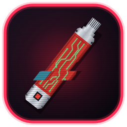

# Capri

A cyberpunk desktop companion. Capri stands in the corner of your screen, listens for
**"Hey Capri"**, and opens your apps and games, plays music, controls Discord, chats with you and more.
Everything she hears is processed on your PC.

**New here? Read the [guides](docs/README.md):** installing her (and the "Windows protected your PC" screen),
setting up her AI, ElevenLabs and Fish Audio voices, languages, Discord, games, and fixes for common problems.

---

## Windows

### Install (easiest)

1. Go to the [latest release](https://github.com/kamome513/capri-companion/releases/latest) and download
   **`Capri.exe`**. That one file is the whole app: no installer, no admin rights, no Python.
2. Put it wherever you like (Desktop, Documents...) and double-click it. The first time each version
   runs, it sets itself up for a few seconds (a small window shows the progress). After that she starts
   straight away.
3. If Windows shows **"Windows protected your PC"**, click **More info**, then **Run anyway**.
   Capri.exe isn't code-signed, so Windows doesn't recognise it.
4. Capri starts in the bottom-right corner. On the first start she downloads her speech model
   (about 40 MB, once).
5. Say **"Hey Capri, open Chrome"** (or any app you have).

Works on Windows 10 and 11. **She updates herself:** once a day she checks for a new version and
downloads it. Next time she starts, the new version replaces that same `Capri.exe`, so your shortcuts,
taskbar pin and "Start with Windows" keep working. Her own files are unpacked into
`%LOCALAPPDATA%\Capri\app\` and old versions there are cleaned up for you.

Prefer a normal install with a Start-menu entry? `Capri-Setup-<version>.exe` is still on every release
and updates itself the same way.

### Run from the code instead

1. Install [Python 3.10 or newer](https://www.python.org/downloads/). In its installer, tick
   **Add python.exe to PATH**.
2. Download this project (green **Code** button → **Download ZIP**) and unzip it.
3. Double-click `run.bat`. The first start takes a few minutes while it installs what she needs.

To make your own `Capri.exe` and installer, double-click `build.bat`. The installer step needs
[Inno Setup 6](https://jrsoftware.org/isdl.php).

---

## Linux

### Install (easiest)

1. Go to the [latest release](https://github.com/kamome513/capri-companion/releases/latest) and download
   **`Capri-x86_64.AppImage`**.
2. Make it runnable: right-click it → **Properties** → **Permissions** → tick **Allow executing file as
   program**. Or in a terminal: `chmod +x Capri-x86_64.AppImage`
3. Double-click it. Nothing to install: no Python, no admin rights.
4. She adds herself to your apps menu. On the first start she downloads her speech model (about 40 MB,
   once). She updates herself like on Windows: keep the AppImage in a folder you own (your home
   folder, Downloads, `~/Applications`...).

It runs on most 64-bit distros from the last few years: Ubuntu 22.04+, Linux Mint 21+, Debian 12+,
Fedora 36+, Arch, Pop!_OS, openSUSE and others.

If it doesn't open, it's usually one of these:
- **Ubuntu 24.04 and newer:** `sudo apt install libfuse2t64`
- **Older Ubuntu / Debian:** `sudo apt install libfuse2`
- Or skip that entirely: `./Capri-x86_64.AppImage --appimage-extract-and-run`

### Run from the code instead

1. Download this project (green **Code** button → **Download ZIP**) and unzip it.
2. Open a terminal in its folder and run `./run.sh`.
3. If your system is missing something, it says exactly what to install for your distro (apt / dnf /
   pacman / zypper). The first start takes a few minutes while it sets her up.

### What works on Linux

Everything in the manual below works on Linux too, with a few differences:
- **Apps:** she finds everything in your apps menu, including Flatpak and Snap apps, plus Steam
  games and games from Lutris, Heroic, itch and others.
- **Her voice:** she speaks with espeak-ng out of the box. Settings → Assistant → *Download Capri's
  voice* gets her proper neural voice (120 MB, once).
- **Reading the screen** ("click subscribe", "highlight deadline") needs Tesseract:
  `sudo apt install tesseract-ocr` (or `dnf` / `pacman`).
- **Media controls** work best with `playerctl` installed. Without it she presses the keyboard's
  media keys.
- **Discord** "mute me" / "deafen me" use your Discord keybinds. Set them in Discord (Settings →
  Keybinds) and in Capri (Settings → PC & chat). Screen sharing isn't supported.
- **Power:** shut down, restart, sleep and lock use your system's own commands (systemd).

### X11 and Wayland

- **X11:** everything works.
- **Wayland** (the default on new Ubuntu and Fedora): she runs through XWayland, which every Wayland
  desktop includes, so she can still stand in her corner and stay on top. But Wayland doesn't let any
  app see or control other apps' windows, so on native Wayland apps:
  - **Typing** needs `wtype` (Sway, Hyprland...) or `ydotool`.
  - **Minimising, sitting on windows and clicking things on screen** only work with apps that also
    run through XWayland (many games, Steam, Discord and older apps do).
  - **Push-to-talk:** apps can't set global hotkeys on Wayland. Add a keyboard shortcut in your
    desktop's settings that runs `/path/to/Capri-x86_64.AppImage --listen` (or `./run.sh --listen`).
    It makes her listen, just like Ctrl+Alt+C.
  - For the full experience, pick an **X11 / Xorg** session on your login screen (the gear icon).

---

## Manual

### Talking to her

Say **"Capri"** or **"Hey Capri"**, then what you want. You can say it in one breath ("Hey Capri,
open Chrome") or pause after her name. Her frame turns green while she's listening.

- **Push-to-talk:** press **Ctrl+Alt+C**, then speak. No wake word needed.
- **Type instead:** right-click her → **Chat with Capri...**
- **Two things at once:** "close Chrome and open Notepad", or "open Notepad then type hello".
- **Stop her talking:** "stop talking" / "shut up".
- **Cancel:** "never mind".

**Your language**

Capri speaks 25 languages: Bulgarian, Croatian, Czech, Danish, Dutch, English, Estonian, Finnish, French,
German, Greek, Hungarian, Italian, Latvian, Lithuanian, Maltese, Polish, Portuguese, Romanian, Russian, Slovak,
Slovenian, Spanish, Swedish and Ukrainian. Pick yours with right-click → **Language**, in Settings → Wake word → **Language**, or say "speak
German", press **Download Parakeet** (about 490 MB, once) and Apply.

- Wake her with "Hey Capri" as usual, then talk in your language. NVIDIA's Parakeet v3 hears it, on your PC.
- Everyday commands work by themselves: open / close apps, play, pause, next, previous, louder, quieter, the
  time, the weather, screenshots, minimise everything.
- With an AI set up she understands everything else too, answers in your language, and her own lines are
  translated (once, then remembered on your PC).
- Her voice: her own neural voice speaks all 25, with each language's pronunciation. Without it, a Windows
  voice for your language if one is installed (Windows Settings → Time & language → Speech → Add voices), or
  espeak-ng. ElevenLabs and Fish Audio speak them all.
- Want only her hearing to change? Tick Settings → Wake word → "Keep her voice when I change language".

### What she does

**Apps, games and websites**

| Say | What happens |
|---|---|
| "open Chrome" / "launch Fortnite" / "start Minecraft" | Opens any app or game you have installed, or a website |
| "close Chrome" / "quit Fortnite" | Closes it. For games she asks "yes or no?" first |
| "open YouTube" / "open twitch dot tv" | Opens the website |
| "search for easy pasta recipes" / "search YouTube for lofi" | Web search (Google, YouTube, Reddit, Wikipedia...) |
| "go into search mode" | She keeps asking what to search next |
| "show me Chrome in File Explorer" / "open my downloads" | Opens the folder |
| "switch tabs on Chrome" / "play the video" | Browser tabs and the video on the page |

**Music**

| Say | What happens |
|---|---|
| "play Bohemian Rhapsody by Queen" | Plays the song (Spotify by default) |
| "play lofi on YouTube" / "on SoundCloud" | Plays it on another music app, just this once |
| "change music to SoundCloud" | Changes where "play ..." goes from now on |
| "pause" / "resume" / "next song" / "previous song" | Controls whatever is playing |
| "turn it up" / "turn it down" | Volume |
| "what's playing?" | Song and artist (needs Spotify connected in Settings) |

**Discord**

| Say | What happens |
|---|---|
| "mute me" / "unmute me" / "deafen me" / "undeafen me" | Mute and deafen, even mid-game without tabbing you out |
| "join call" | Joins the voice channel you saved in Settings |
| "leave call" | Leaves the call |

**Your PC**

| Say | What happens |
|---|---|
| "minimise everything" / "bring them back" | Hides all windows, then restores them |
| "minimise Chrome" / "minimise this" | Minimises one window |
| "lock my PC" | Locks it |
| "shut down" / "restart" / "put my PC to sleep" | Asks you first. Only a clear "yes" does it |
| "take a screenshot" / "screenshot this window" | Saves it to Pictures\Screenshots |
| "what's using all my RAM?" / "how much storage is left?" / "battery?" | Live PC stats |
| "why is my game lagging?" / "my FPS is so low" | Checks CPU, memory, graphics card (NVIDIA), heat, disk and ping, and says the most likely cause |
| "how's my internet?" / "what's my ping?" / "run a speed test" | Ping, how steady it is, and a quick download speed test |
| "put Chrome on the left and Discord on the right" / "Spotify full screen" / "snap this to the left" | Arranges your windows |
| "put Chrome and Discord side by side" | Splits the screen between them |
| "turn Discord down" / "make Spotify louder" / "set Chrome to 30%" / "mute the sound of Chrome" | Changes only that app's volume (Windows volume mixer; Linux: pactl) |
| "type hello in Notepad" / "type hello" | Types it for you. She never presses Enter |
| "click subscribe" / "click that" | Clicks a button you can see on screen |
| "highlight hello" / "copy that" / "right click that" / "scroll down" | Hands on your screen |

**Clips**

| Say | What happens |
|---|---|
| "clip that" / "clip it" | Saves the last 30 seconds of your screen and sound as a video (Videos\Capri Clips) |
| "clip the last minute" / "clip the last 2 minutes" / "save the last 45 seconds" | Saves that much (up to 2 minutes) |

Turn on **Clip my games** in Settings → Extras first. While it's on, she keeps the last two minutes
recording (only while you're in a game, unless you pick *Always*), on your PC. On Windows the recorder
(ffmpeg, about 31 MB) downloads once when you turn it on. On Linux install ffmpeg first
(`sudo apt install ffmpeg`).

**Your screen**

| Say | What happens |
|---|---|
| "what do you see?" / "look at my screen" / "what am I doing?" / "what do you think of this?" | She looks at your screen and answers |
| "watch my screen" / "stop watching my screen" | She glances at your screen every few minutes and comments |

Needs an AI that can see pictures (ChatGPT, Gemini, Claude, or Ollama with `gemma3` / `llava`). Using the free local brain from "set up your brain"? Its llama3.2 can't see: say **"give yourself eyes"** and she downloads gemma3 into Ollama (about 3 GB, once). If your model
can't, she uses that service's own picture model by herself (NVIDIA, Groq, Mistral, xAI, OpenRouter). If the service won't take pictures at all, she reads the text on your screen on your PC and asks about that instead. She looks
at the monitor your window is on. A game in exclusive fullscreen shows up black to her: switch it to borderless
or windowed. On Linux it needs an X11 session (Wayland doesn't allow screenshots). The picture goes to that AI. With Ollama it stays on your PC. She won't look while a password manager, bank, sign-in
page or private window is in front.

**She plays your game**

| Say | What happens |
|---|---|
| "play this for me" / "your turn" / "take over" | She plays the game in front of you |
| "play this for me and get some wood" / "take over and find a cave" | ...with a goal |
| "my turn" / "hands off" / "stop playing the game" - or press **Esc** | She stops at once |

Turn on *Let her play games* in Settings → Extras (she asks the first time). She looks at the game with
your AI (it must be one that can see pictures), then holds keys, turns the camera and clicks - her own
red cursor shows where. She only uses game keys (letters, numbers, space, shift, ctrl, tab, arrows), one at
a time, only in that game's window, and stops if you switch away or after 5 minutes. She's slow and still
learning: simple goals work best.

**Moving her around**

| Do / say | What happens |
|---|---|
| Drag her | Moves her |
| Right-click her → **Size** / "make yourself bigger" / "make yourself tiny" / "normal size" | Tiny, Small, Normal, Big, Bigger or Huge (her feet stay put) |
| Flick her and let go | Throws her. Hit a wall hard and she slams into it (the screen overloads: electric arcs, glitch tearing, impact lines, dead pixels), bounces off, sees stars and gets up |
| Click her head | A head pat (click her body: a poke) |
| Move your mouse over her | She floats up a little and leans toward your cursor |
| Drag her | She dangles from your cursor, swinging behind the way you move |
| "teleport" / "go for a walk" / "stay there" / "start roaming" | Her power closes in around her and she teleports somewhere else along the bottom, or stays put |

**Timers, time and weather**

| Say | What happens |
|---|---|
| "set a timer for 5 minutes" / "wake me up at 7:30" | Timers and alarms |
| "how long is left?" / "cancel the timer" | Checks or stops it |
| "what time is it?" / "what's the date?" | Time and date |
| "what's the weather?" / "tomorrow" / "in Tokyo" | Weather (set your home city in Settings) |
| "is it going to rain?" | Chance of rain |

**Chatting**

Just talk: "how are you", "tell me a joke", "what is a black hole", "flip a coin", "what's 12 times 8".
She has her own chatbot that always answers. If you add an AI in Settings (ChatGPT, Gemini,
Claude, Ollama...), she chats like a real conversation.

**Her memory of you (private)**

| Say | What happens |
|---|---|
| "my name is Alex" / "I love pizza" / "my favourite movie is Shrek" / "I'm from London" | She remembers it |
| "remember that my exam is Friday" | She remembers that too |
| "what's my name?" / "what do you know about me?" | She tells you |
| "forget that I love pizza" | Forgets one thing |
| "forget everything about me" | Asks first, then deletes it all |

It's saved only on your PC. Personal things are answered by her own chatbot and never sent to the
AI, unless you tick *Let the AI know what Capri remembers about me* in Settings → Assistant.

**Teaching her**

| Say | What happens |
|---|---|
| "when I say study time, open Chrome and Notepad" | Your own shortcut |
| "forget the shortcut study time" | Deletes it |
| "when I say note bad I mean Notepad" | Fixes a word she keeps mishearing |
| "this button makes me skip ad" (pointing at it with the mouse) | She learns that button |
| "forget the skip ad button" | Forgets it |

**Her look and mood**

| Say | What happens |
|---|---|
| "be sarcastic" / "be sweet" / "what's your personality?" | Changes how she talks |
| "talk faster" / "talk slower" / "talk louder" / "talk softer" / "talk higher" / "talk lower" | Changes her voice |
| "change your hair" | Swaps between her two hairstyles |
| "lie down" / "get up" | Lies on her panel, or stands up |
| "sit on my window" / "stop sitting on windows" | She sits on top of the window you're using |
| "go to the bottom left" | Moves her to another corner |
| "compact mode" / "normal size" | Small or normal text box |
| "hide" / "come back" | Hides her (she still listens) |
| "drone mode" / "normal mode" | Turns her into a little flying drone, and back |
| "turn on game hype" / "turn off game hype" | Cheers when you get kills |
| "repeat what I said" / "say that again" | Repeats you, or herself |
| "open your settings" | Opens her Settings |
| "check for updates" / "update yourself" | Looks for a newer Capri / installs a downloaded one (asks first) |
| "restart yourself" / "restart Capri" | Closes and starts her again (a downloaded update installs on the way) |

### Right-click menu (or the tray icon by the clock)

| Item | What it does |
|---|---|
| **Hide Capri** | Hides her until you show her again (clicking the tray icon does too, or Ctrl+Alt+H) |
| **Quiet mode** | She doesn't comment by herself (game hype, screen comments, warnings) but still answers you (Ctrl+Alt+P) |
| **Chat with Capri...** | A window to type to her (Ctrl+Alt+T from anywhere) |
| **Listen now** | Push-to-talk: she listens for one command (Ctrl+Alt+C) |
| **Voice → Voice activation** | Listen for "Hey Capri". Off closes the microphone (push-to-talk still works) |
| **Voice → Mute microphone** | Fully closes the mic. Nothing can open it, not even push-to-talk |
| **Voice → Spoken replies** | She talks out loud, or only writes |
| **Voice → Microphone** | Pick which microphone she uses |
| **Capri → Design** | Her art style (full body, portrait, classic, or an animated picture) |
| **Capri → Lie on the panel** | She lies on top of her message panel |
| **Capri → Sit on windows** | She hops onto the window you're using |
| **Capri → Compact mode** | Smaller, one-line text box (she stays her size) |
| **Capri → Hair** | "Like the show" or "Classic spiky" |
| **Capri → Personality** | Edgerunner, Sarcastic, Silly, Tsundere, Sweet, Deadpan, Gremlin, Hype, Kuudere |
| **Capri → Do something** | Glitch, play a game, watch something, or call D |
| **Panel → Show status panel** | Her message panel on or off |
| **Panel → Text box opens** | Always, when she has something to say, only when you say her name, or never |
| **Panel → Show activity log** | The log lines under her message |
| **Panel → Activity log style** | Log inside the panel, or as call cards above it |
| **Drone → Drone mode now** | Turn into the little drone right now |
| **Drone → Drone mode when I'm in a game** | Turn into the drone automatically while you play |
| **Drone → Look** | Disk or Mask (green visor) |
| **Window → Always on top** | Keep her above other windows |
| **Window → Click-through** | Clicks go straight through her (Ctrl+Alt+Shift+C toggles it) |
| **Window → Reset position** | Back to the bottom-right corner |
| **Start with Windows** (Linux: **Start when I log in**) | Starts Capri when you sign in |
| **Check for updates** / **Restart to update** | Looks for a newer Capri. Once one is downloaded, restarts her to install it (asks first) |
| **Settings...** | Opens Settings (below) |
| **Guides and help** | Opens the step-by-step guides on GitHub |
| **Open log folder** | Opens `capri.log`, handy if something goes wrong |
| **Restart Capri** | Closes and starts her again. A downloaded update installs on the way |
| **Exit Capri** | Quits |

You can **drag** Capri or her panel anywhere, on any monitor.

### Settings

**Apps tab:** the apps and games she opens and closes by name.

| Button / column | What it does |
|---|---|
| **Name (say this)** | What you say: "open *Name*" |
| **Also say** | Other words for it, separated by commas (e.g. *my browser* for Chrome) |
| **Type** | Program, Steam game, or Website / link |
| **Where it is** | The program's path, the Steam game's number, or the link |
| **Found?** | ✓ she can find it, ✗ it's missing (and why), • she'll look it up in the Start menu |
| **Add app or game...** | Pick from everything installed on your PC. Tick as many as you like |
| **Add my games** | Adds every game you've downloaded (Steam, Epic, Xbox, Riot, GOG, EA, Ubisoft...) |
| **Change path...** | Point the selected app at a different program file |
| **Remove** | Takes the selected app off the list |
| **Test launch** | Opens the selected app now |
| **Show advanced** | Shows arguments, process names, and what "close" does (like clicking X / ask me first / force quit) |
| **Save** | Saves your changes |
| **Try a command** | Type what you'd say and see what she'd do. Nothing actually runs |

**Found on this PC tab:** everything she can open without setup. **Rescan** looks again after you
install something.

**Wake word tab:** how she hears you.

| Button / setting | What it does |
|---|---|
| **Wake word confidence** | Higher = fewer false wake-ups. Lower = she hears you more easily |
| **Teach her your voice** | Say "Hey Capri" 4 times so she learns how you say it |
| **Download the more accurate speech model** | Better understanding (128 MB) |
| **Hearing** | Vosk (quick and light), Parakeet (best for heavy accents) or Whisper |
| **Download Parakeet** | Gets the accent-friendly model (480 MB, once). Runs offline. Uses about 900 MB of RAM, freed while you game |
| **Install Whisper** | Another accent-friendly option |
| **Clean up my mic** | Turns a quiet mic up and cuts rumble and hiss |
| **Push-to-talk / Click-through hotkey** | Change the keyboard shortcuts |
| **Apply** | Uses the changes |
| **Fix what she mishears** (Add / Remove / Fix what she just heard) | "When she hears *note bad*, read it as *notepad*" |

**Character tab:** her look.

| Setting | What it does |
|---|---|
| **Style** | Full body, portrait, classic, or an animated picture. Drop your own pictures in the `looks` folder |
| **Hair** | Like the show, or Classic spiky |
| **Body** | Full colour (her solid colours, the default) or Neon (dark, with glowing red and green edges) |
| **In games** | Stay herself over the game, or turn into the drone |
| **Drone look** | Disk or Mask |
| **Idle animation** | Breathing, blinking, looking around |
| **Lie on the panel** / **Sit on windows** / **Idle activities** | Same as in the right-click menu |

**Assistant tab:** her voice, weather, music and AI.

| Button / setting | What it does |
|---|---|
| **Spoken replies** | Talk out loud or not |
| **Night City slang** | "Preem, choom." On or off |
| **Personality** | How she talks |
| **Voice** | Her neural "Capri" voice, Windows voices (Linux: espeak-ng), ElevenLabs, Fish Audio or beeps |
| **Download Capri's voice** | Her neural voice (120 MB, once) |
| **ElevenLabs key / voice** | Use an ElevenLabs voice (needs their key) |
| **Fish Audio key / voice** | Use a Fish Audio voice (sign up free at fish.audio, they give free credits). Paste a voice's link or ID from their library |
| (online voices) | ElevenLabs and Fish Audio play exactly as the service makes them, so Style, Pitch and Expression are hidden while you use one |
| **Style, Volume, Speed, Pitch, Expression** | Tune how she sounds |
| **Test voice** / **Capri preset** | Hear her / reset to her default sound |
| **Home city, Units, Test weather** | For "what's the weather" |
| **Play music on** | Spotify, YouTube Music, SoundCloud, YouTube... |
| **Client ID, Connect, Disconnect, Test Spotify** | Connect Spotify (Premium) so she can start exact songs and say what's playing |
| **Chatbot** | Chat with her about anything |
| **AI, Address, API key** | Pick an AI and paste its key: ChatGPT, Gemini (free key), Groq, NVIDIA (build.nvidia.com, free credits), OpenRouter, DeepSeek, Mistral, xAI, Claude, Ollama... |
| **Set up Ollama for me** | A free AI that runs on your PC, no key needed: installs Ollama, downloads a model that suits your PC (about 3 GB) and switches her to it. Or say "set up your brain" |
| **Model** / **Show my models** | Pick from the models your key (or Ollama) actually has. Empty = a sensible default |
| **Test AI** / **Last try** | Checks the AI works, and shows what happened last time |
| **Let the AI know what Capri remembers about me** | Off by default: your memory stays on your PC |
| **She knows** / **Forget everything about me** | What she remembers, and a button to wipe it |
| **Save** | Saves your changes |

**PC & chat tab:**

| Setting | What it does |
|---|---|
| **Keep chatting** | After she asks you something, she listens for the answer without "Hey Capri" |
| **Red lag lightning** | Her zap effects when she presses Discord buttons or closes windows |
| **Greet me when I sign in** / **Big, in the middle** / **Preview greeting** | Her hello when you sign in or wake the PC |
| **Start Capri with Windows** (Linux: **when I log in**) | Same as the menu item |
| **Update automatically** / **Check for updates now** | Daily check for a new Capri: downloads it and installs it on her next start. Off = she only tells you |
| **Restart Capri** | Closes and starts her again (installs a downloaded update) |
| **Game hype** (cheer for kills, say something when I die, watch my screen, encourage me) / **Preview** | Hype while you play: CS2, Dota 2 and League directly, any game by reading your screen |
| **Toggle Mute / Deafen keybind** | Your Discord keybinds, if you changed Discord's defaults |
| **Show "Playing Capri" on my Discord profile** | Your friends see animated Capri on your profile with **Get Capri** and **Join her Discord** buttons (Discord hides your own buttons from you; friends see them). It says **Plugged in**, or **Vibing to music** while a music app or music site plays (never which song). While you're in a game it says **Playing <your game> with Capri** (the name from your Steam library, or the game's own program) |
| **Your voice channel** / **Leave call keybind** / **Join it now** | For "join call" and "leave call". Right-click the channel in Discord → Copy Link |
| **Save** | Saves your changes |

**Extras tab:** the things you can switch on.

| Setting | What it does |
|---|---|
| **Text box** | Always there, only when she talks back (it pops up, then hides again), only when you say her name ("hey Capri": not for things she says by herself), or never (just her) |
| **Show what you said, and TYPE / TALK buttons** | Her text box shows "YOU ›" what she heard; TYPE opens the chat to type to her, TALK makes her listen now |
| **She glitches** | Never (the default), or every 1, 3, 5 or 10 minutes her picture glitches like a broken video feed |
| **Music deck** | While music plays, she stands on a neon bar (lying down, she lies on it): the song, and previous / play-pause / next. Also in the tray menu (Capri → Music deck), or say "hide the music bar" / "show the music bar" |
| **She vibes to your music** | While music plays she bounces and sways to it (and stops when you pause) |
| **Let her play games** | "Play this for me" (see She plays your game above) |
| **Clip my games** / Record / "Clip that" saves / Frame rate / Resolution / With sound / Save big moments | Clips (see Clips above). *Save big moments* clips triple kills, aces and wins by itself (needs Game hype) |
| **Choose folder / Open clips folder** | Where clips go (Videos\Capri Clips) |
| **Watch my screen and comment** / How often / Remember what she sees | She glances at your screen and comments (see Your screen above) |
| **Throw her** / **Roam around** / **Head pats** | Flick-and-throw; teleporting along the bottom now and then (off unless you turn it on; never while she is busy or you are in a game, and she always comes back to her corner); reacting to clicks |
| **Also play her voice on** | Her voice in your mic: pick a virtual cable (VB-Audio "CABLE Input", free) or "Steam Streaming Speakers", then pick the matching mic in Discord or Roblox. Your friends hear her |

### Privacy

- The only other thing she contacts on her own is GitHub, once a day, to check for updates (turn it
  off in Settings → PC & chat).
- She only listens for "Hey Capri". That runs on your PC, and audio is never recorded or uploaded.
- Your settings, apps list and memory of you are kept in your own user folder
  (`%LOCALAPPDATA%\Capri` on Windows, `~/.config/Capri` on Linux). Delete `settings.json` there to reset her.
- Only what you say to the AI (if you set one up) goes to that AI. Personal things don't, and your
  Windows user name is removed from anything that does.
- On Discord, your profile shows "Playing Capri" while she's open, whether you're listening to music (never which
  song), and "Playing <game> with Capri" while you game. Nothing else about what you do is shown. To check for music, she
  asks Windows' sound mixer (Linux: your media players) which apps are making sound. Turn it off in
  Settings → PC & chat (Discord's own Activity Privacy setting also applies).
- **Watch my screen** and "what do you see?" send a picture of your screen to the AI you picked (with Ollama it
  stays on your PC). It's off until you turn it on, and she won't look at password managers, banks, sign-in
  pages or private windows.
- **Clips** are recorded and saved on your PC only.
- She never runs commands an AI makes up. She can only do the fixed actions in this manual, and
  shutting down, restarting or sleeping always asks you first.

### Something wrong?

| Problem | Fix |
|---|---|
| She doesn't react to "Hey Capri" | Check the right microphone is picked (right-click → Voice → Microphone). Try **Teach her your voice**, or lower the wake word confidence |
| She wakes up by mistake | Raise the wake word confidence |
| A download fails ("certificate verify failed") | Your antivirus is probably scanning HTTPS. Allow Capri, or turn off its "HTTPS scanning" / "web shield" for a minute, and try again |
| She mishears your accent | Settings → Wake word → **Download Parakeet**, then pick it under Hearing |
| She can't find an app | Settings → Apps → **Add app or game...**, or add what she hears to **Also say** |
| I want a free AI without a key | Settings → Assistant → AI → **Set up Ollama for me**, or say "Hey Capri, set up your brain". She does the rest |
| "I don't have Ollama installed" but you do | Open the Ollama app once (it sits by the clock), then say "set up your brain". If you changed Ollama's address, put it in Settings → Assistant → Address |
| She says she crashed last time | Send the `crash.log` from her log folder (right-click her → Open log folder) to the Capri Discord |
| She keeps saying the AI turned something down (400) | She already retries by herself. If it keeps happening, the reason she reads out (and the line in `capri.log`) says what the service didn't like. Often it's a model that can't do pictures (for *Watch my screen*) or doesn't support her tools: pick another model in Settings → Assistant |
| The AI says a model "doesn't exist" | Settings → Assistant → **Show my models** and pick one from the list |
| She crashed (Linux) | Send `crash.log` and `capri.log` from `~/.config/Capri` - since 1.40 they say why |
| "Mute me" doesn't work | Put your Discord keybinds in Settings → PC & chat. Don't run Discord "as administrator" |
| Her voice sounds robotic | Settings → Assistant → **Download Capri's voice** |
| She vanished | Click the tray icon by the clock, or start Capri again |
| Can't click her | Click-through is on: press Ctrl+Alt+Shift+C |
| Anything else | Right-click → **Open log folder** and look at `capri.log` |

---

## License

Capri's code is open source under the [MIT License](LICENSE). The installer also bundles other
projects under their own licenses, and the character art is fan art that the MIT License doesn't
cover. See [THIRD_PARTY_NOTICES.md](THIRD_PARTY_NOTICES.md).
